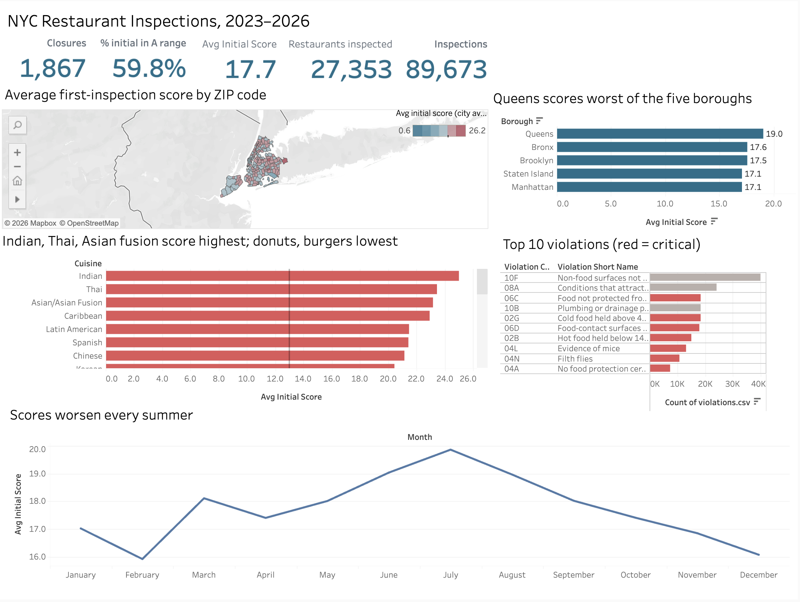
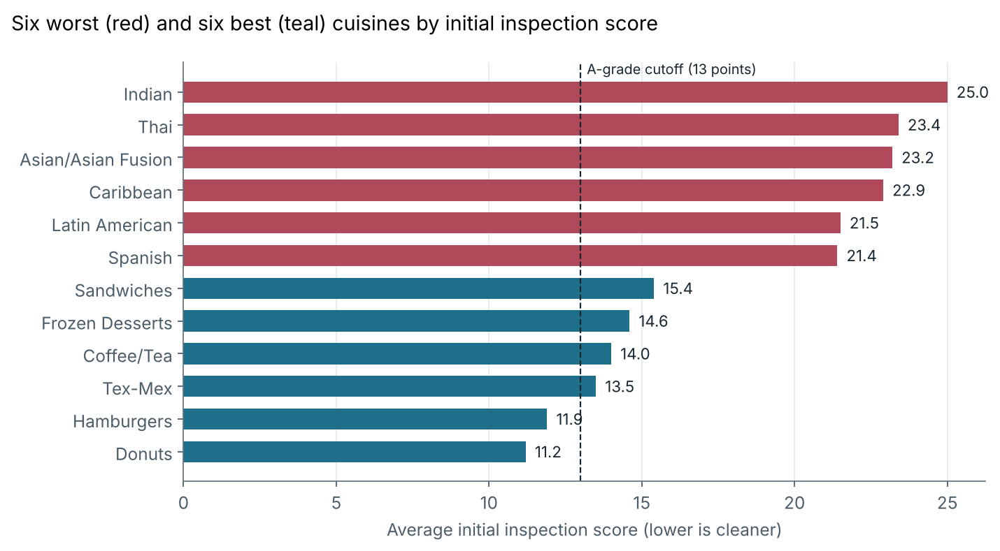
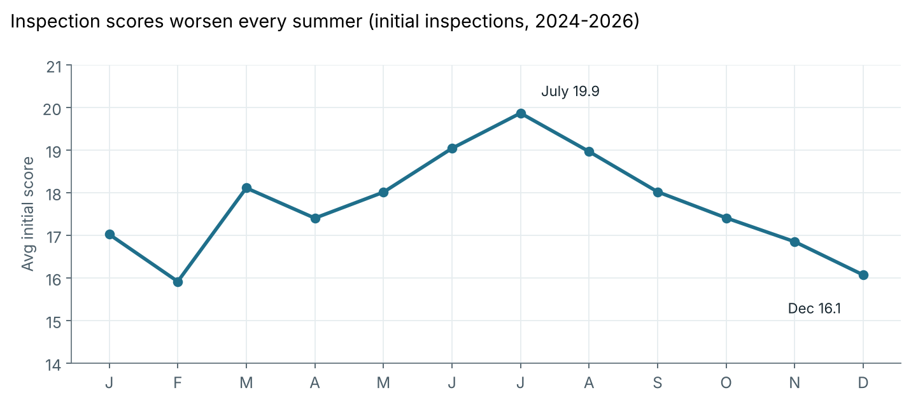
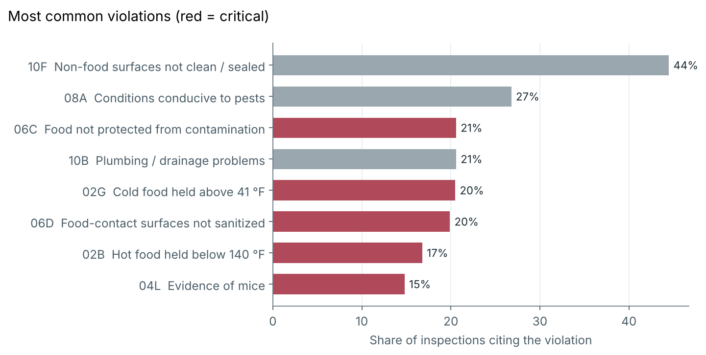

# NYC Restaurant Inspections: Where and When Kitchens Fall Short

An analysis of **89,673 health inspections of 27,353 New York City restaurants** (January 2023 to October 2026), built with Python, SQL and Tableau.

**Interactive dashboard:** [add your Tableau Public link] · **Tools:** Python (pandas), SQL (SQLite), Tableau Public

> Inspection scores work like golf: **lower is better**. The city awards an A for 0-13 points, a B for 14-27 and a C for 28 or more.



## Business questions

1. How clean are NYC restaurants on a first, unannounced inspection?
2. Which boroughs and cuisines perform worst, and which perform best?
3. What problems do inspectors find most often?
4. Is there a time of year when conditions get worse?
5. When a restaurant fails to earn an A, how often does it fix the problems by re-inspection?

## Key findings

- **The A in the window hides a rougher first visit.** 87% of posted letter grades are A, but only **60% of initial inspections** score in the A range, and **88%** cite at least one critical violation. Many restaurants earn their A only after fixing problems before the re-inspection.
- **Cuisine matters more than borough.** Average initial scores range from **11.2 (donuts) and 11.9 (hamburgers)** to **25.0 (Indian), 23.4 (Thai) and 22.9 (Caribbean)**. Boroughs vary much less, from 17.1 in Manhattan and Staten Island to 19.0 in Queens. Menus that involve more cooking and holding of food have more ways to go wrong, so this partly reflects complexity, not just care.
- **Pests and surfaces top the list.** Unclean or unsealed non-food surfaces appear in **44%** of inspections, conditions that attract pests in **27%**, and evidence of mice in **15%**.
- **Summer is the riskiest season.** Initial scores average **19.3 in June-August versus 16.4 in December-February** (2024-2026), and closures per inspection peak in August.
- **Re-inspections work.** Restaurants that miss an A on the initial inspection average 29.3 points, then **17.5 on the re-inspection**, and **63%** reach the A range.
- **Closures concentrate in a small group.** 1,268 restaurants were closed by the health department at least once, and **416 of them were closed two or more times**.

| | |
|---|---|
|  |  |



## How it was built

1. **Cleaning (Python, `src/clean_data.py`):** removed 186 exact duplicate rows, parsed dates, replaced 0,0 coordinates with blanks, recovered missing boroughs from ZIP codes where possible, and collapsed the one-row-per-violation export into three tables:
   - `inspections.csv`: one row per inspection with restaurant details, score, grade, violation counts and closure flag
   - `violations.csv`: one row per violation cited
   - `violation_codes.csv`: lookup of violation descriptions and critical flags
2. **Analysis (SQL, `sql/`):** seven queries against a SQLite database, run by `src/run_queries.py`, with results saved in `outputs/`. One uses correlated subqueries to pair each failed initial inspection with its own re-inspection.
3. **Dashboard (Tableau Public):** KPIs, a ZIP-code map, borough and cuisine comparisons, top violations and a monthly trend, with linked filters. Step-by-step build notes are in [`docs/tableau_build_guide.md`](docs/tableau_build_guide.md).

**Method note:** score comparisons use **initial cycle inspections only**. Re-inspections follow a failed visit, so mixing them in would distort comparisons between groups.

## Repository layout

```
data/clean/     cleaned tables used by Tableau (inspections, violations, violation_codes)
sql/            the seven analysis queries
src/            clean_data.py, run_queries.py, make_preview_charts.py
outputs/        query results as CSV
figures/        README charts and dashboard screenshot
docs/           Tableau build guide
```

## Reproduce it

1. Download the raw CSV from [NYC Open Data: DOHMH New York City Restaurant Inspection Results](https://data.cityofnewyork.us/Health/DOHMH-New-York-City-Restaurant-Inspection-Results/43nn-pn8j) (this project used inspections from 2023 onward, exported October 2026).
2. Save it as `data/raw/restaurant_inspections_raw.csv`.
3. From the repository root:

```bash
pip install -r requirements.txt
python src/clean_data.py         # builds data/clean/ and data/restaurant_inspections.db
python src/run_queries.py        # runs every query in sql/ and writes outputs/
python src/make_preview_charts.py
```

## Limitations

- **Earlier months are thinner.** 2023 has far fewer records than later years, likely because the city's export keeps recent inspection history for restaurants that are still active. Trends are most reliable from 2024 onward.
- **Scores measure conditions on inspection day,** not overall food safety or the risk of illness.
- **Cuisine labels are self-reported categories,** and differences partly reflect menu complexity.
- **Correlation, not causation:** the seasonal pattern fits heat and pest activity, but this data cannot prove the cause.

## Data source

NYC Department of Health and Mental Hygiene, via [NYC Open Data](https://data.cityofnewyork.us/Health/DOHMH-New-York-City-Restaurant-Inspection-Results/43nn-pn8j). Public data.
